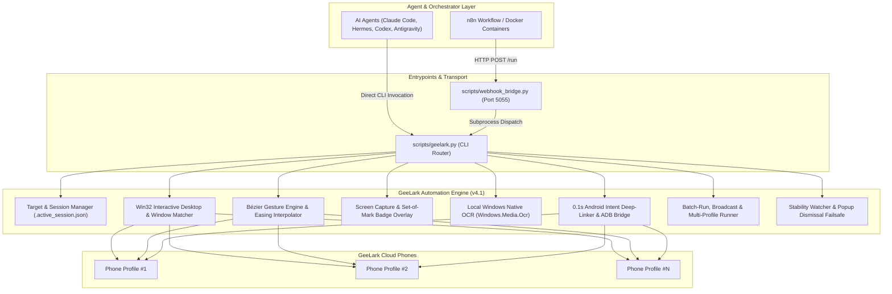

# GeeLark Cloud Phone Automation Skill — Architecture & Feature Reference

This document provides a comprehensive technical reference for the **GeeLark Cloud Phone Automation Skill** (v4.1 Production Edition). Engineered according to the open **Agent Skill Standard**, it enables autonomous AI agents (**Claude Code, Hermes, OpenClaw, OpenAI Codex, Antigravity**) and external orchestrators (**n8n, Docker**) to control, automate, and inspect GeeLark cloud phones with token efficiency and anti-bot defense.

---

## 🏗️ System Architecture



---

## 🌟 Complete Feature Catalog

### 1. Target Management & Profile Persistence
- **Command**: `python scripts/geelark.py use <profile_number_or_name>`
- **Description**: Binds the CLI session to a specific phone profile (e.g. Profile 4). The selection is persisted to `.active_session.json` so agents never need to re-supply `--window` or `-w` in subsequent commands.
- **Fail-Safe Isolation**: If a profile target is set to `"4"`, window matching strictly matches `#4` or `Profile 4` without falsely matching `#14` or `#40`. If the targeted window is not open, the system cleanly returns an error instead of dangerously executing clicks on window 0.
- **Session Cache Resilience**: Corrupted or empty `.active_session.json` files are automatically handled without crashing, defaulting safely to window discovery.

### 2. Window Discovery & Coordinate Offsets
- **Commands**: `list-windows`, `status`, `focus`
- **Window Specs**:
  - Top title bar offset: `30px`
  - Right-side control toolbar: `44px`
  - Active touchscreen display area: `(width - 44px) x (height - 30px)`
- **Multi-Monitor Support**: Supports virtual desktop coordinates spanning negative coordinates (e.g., secondary monitors placed to the left or above the primary display) using `SM_XVIRTUALSCREEN` and `SM_YVIRTUALSCREEN`.

### 3. Human-like Bézier Touch & Gesture Engine
- **Commands**: `tap`, `swipe`, `type`, `key`, `hide-keyboard`
- **Anti-Bot Defense**: Social media platforms (TikTok, Instagram, YouTube) analyze swipe trajectories and velocities. GeeLark's gesture engine calculates smooth **cubic Bézier curves** with randomized thumb jitter ($\pm 16\text{px}$) and non-linear velocity easing:
  $$\text{ease\_in\_out}(t) = 3t^2 - 2t^3$$
  This produces slow acceleration and gentle deceleration, mimicking genuine human thumb physics.
- **Normalized Coordinates (`--norm`)**: Accepts `0.0` to `1.0` floats, translating proportionally to the active touchscreen dimensions regardless of physical monitor resolution.
- **Key Mappings**:
  - `back` $\rightarrow$ Normalized tap `(0.18, 0.97)`
  - `home` $\rightarrow$ Normalized tap `(0.50, 0.97)`
  - `recent` / `appswitch` $\rightarrow$ Normalized tap `(0.82, 0.97)`
  - `enter`, `tab`, `esc`, `backspace` $\rightarrow$ Native virtual key codes

### 4. Visual Capture & Set-of-Mark (SoM) Indexing
- **Commands**: `capture`, `tap-mark`
- **Set-of-Mark (SoM) Numbered Badges**:
  - `python scripts/geelark.py capture --annotate` runs local OCR, detects interactive text labels, draws high-contrast cyan bounding boxes and numbered badge tags (`[1]`, `[2]`, ...), and saves coordinates to `.marks_cache.json`.
  - The agent receives a structured compact text summary, allowing immediate element targeting via `python scripts/geelark.py tap-mark <id>` without coordinate hallucination.
- **Token Optimization (`--low-token`)**: Downsamples high-resolution captures to 800px height, saving ~70% of multimodal vision tokens for Claude 3.5 Sonnet, GPT-4o, and Gemini models.

### 5. Windows Native OCR Subsystem
- **Commands**: `find-text`, `click-text`, `wait-text`, `scroll-find`
- **Zero-Dependency Architecture**: Employs `scripts/ocr_helper.ps1` via the Windows Runtime API `Windows.Media.Ocr.OcrEngine`.
  - **Latency**: ~80ms local execution.
  - **Cost**: $0 token consumption.
  - **Fallback**: Automatically defaults to user system language, falling back to `en-US`.
- **Autonomous Scroll-Find (`scroll-find`)**: Loops through OCR scanning, vertical scrolling, and element clicking. Accomplishes in a single local execution what previously took 4–6 LLM turns, reducing token costs by >80%.

### 6. App Launching & 0.1s Deep-Linking
- **Commands**: `open-app`, `deep-link`
- **Instant Intent Dispatch**: Dispatches `android.intent.action.VIEW` directly via bundled ADB. Opens YouTube videos, web URLs, or app deep-links in 0.1 seconds without keyboard navigation or typing.
- **Visual Fallback**: If ADB is offline or inaccessible, automatically falls back to opening Chrome, focusing the omnibox, pasting the target URL via Windows clipboard injection (`GlobalAlloc`/`SetClipboardData`), and pressing Enter.

### 7. 1-Click High-Level Automated Recipes
- **`youtube-flow`**:
  - Dispatches deep-link directly to YouTube video URL.
  - Monitors screen for pre-roll ads and auto-taps "Skip".
  - Dismisses overlay modals and premium promotions.
  - Expands video description by clicking "...more" and scrolls down to click links matching domain or `http`.
- **`tiktok-feed`**:
  - Launches TikTok app.
  - Clears initial popups.
  - Loops across $N$ videos with randomized human watch durations ($\text{min\_watch} \le t \le \text{max\_watch}$).
  - Performs natural Bézier vertical swipe gestures.
  - Simulates organic user behavior by double-tapping to like according to `like_ratio`.

### 8. Multi-Device Orchestration
- **`batch-run`**:
  - Executes a multi-step sequence from a JSON file path, inline JSON string, or Python dictionary.
  - Supports 16 distinct actions (`tap`, `swipe`, `type`, `key`, `open-app`, `deep-link`, `click-text`, `wait-text`, `scroll-find`, `dismiss-popup`, `hide-keyboard`, `wait-stable`, `sleep`, `capture`, `youtube-flow`, `tiktok-feed`).
  - Supports per-step target window overrides (`"window": "..."` or `"target": "..."`).
  - **Defensive Execution**: Inner step failures or exceptions are logged in the step result, allowing remaining steps to complete without halting the entire run.
- **`broadcast`**:
  - Multicasts a command (e.g. `dismiss-popup`, `key home`, `deep-link <url>`) simultaneously across **all open phone windows**.
  - Isolates exceptions per window so an error on one phone does not impede others.
- **`batch-profiles`**:
  - Sequentially runs commands across specific profile subsets (`--profiles 1,2,4` or `--profiles all`).

### 9. Self-Healing, Obstacle Clearance & Failsafes
- **`dismiss-popup`**:
  - Performs single-pass OCR scan against an extensive dictionary of dismissal keywords:
    `["Skip Ads", "Skip Ad", "Skip in 5s", "Skip trial", "Skip", "Not now", "No thanks", "Later", "Cancel", "Close", "Dismiss", "Don't allow", "While using the app", "Allow", "OK"]`
  - Immediately taps detected buttons; if no button is detected, issues a non-destructive Android Back key.
- **`wait-stable`**:
  - Compares consecutive frame pixel differentials using Pillow `ImageChops.difference`.
  - Halts execution until rendering transitions or video buffering stabilizes.
- **`recover`**:
  - Issues double Back keys followed by Android Home key and captures the resulting home screen to restore known state.

### 10. Webhook Bridge & n8n Integration
- **Script**: `scripts/webhook_bridge.py`
- **Default Port**: `5055`
- **Endpoints**:
  - `GET /health`: Health and liveness verification.
  - `GET /`: API documentation and available routes.
  - `OPTIONS /run`: CORS preflight negotiation.
  - `POST /run`: Accepts JSON payload `{"command": "...", "args": [...]}` and forwards execution to `geelark.py`.
- **Error Handling**:
  - HTTP 400 for malformed JSON or missing command.
  - HTTP 404 for invalid endpoints.
  - HTTP 500 for CLI non-zero exit codes.
  - HTTP 504 for command timeouts (>90 seconds).

---

## 🛡️ Edge Case & Defensive Engineering Matrix

| Failure Mode / Edge Case | Handled By | Defensive Strategy |
| :--- | :--- | :--- |
| **Similar Profile Numbers (#4 vs #14)** | `find_target_window` | Prioritizes exact pattern matching (`#<target>`, `Profile <target>`, `|<target>`) before general substring searches. |
| **Target Profile Not Open** | `find_target_window` | Returns `None` instead of falling back to window 0, preventing accidental interactions on the wrong device. |
| **Corrupted Session/Marks Cache** | `get_active_target`, `tap_mark` | Wrapped in `try...except Exception`, safely ignoring malformed JSON and returning structured error payloads. |
| **Virtual Keyboard Occlusion** | `hide_keyboard` | Issues normalized Back key tap without leaving the active app view. |
| **Non-Windows / Headless Environment** | Multi-Platform Guards | Win32 calls are protected by `IS_WINDOWS` checks with informative runtime errors and safe metadata mode. |
| **Batch Step Exception** | `execute_batch_steps` | Catches exceptions at the step level, reporting `status: "error"` for that step while continuing remaining steps. |
| **Inner Step Error Propagation** | `execute_batch_steps` | Inner action dictionaries returning `status: "error"` properly flag the batch step as an error. |
| **Broadcast / Batch Profile Partial Failures** | `broadcast_action`, `batch_profiles` | Window-specific exceptions are captured per device without aborting execution on other devices. |
| **Malformed Webhook HTTP Requests** | `webhook_bridge.py` | Validates Content-Length, checks body type (rejecting non-dict JSON), and isolates subprocess timeouts with HTTP 504. |

---

## 🧪 Automated Test Suite

The test suite provides thorough verification across all features and edge cases:

```bash
# Run full unit and integration test suite
python3 -m unittest discover tests
```

### Test Structure
- `tests/test_geelark.py`:
  - `TestGeeLarkCoreFeatures`: Bézier math, target persistence, corrupt cache handling, window matching, screen geometry.
  - `TestGeeLarkGesturesAndInput`: Key dispatches, keyboard hiding, normalized coordinate translation, platform guards.
  - `TestGeeLarkSetOfMarkAndOCR`: Missing/corrupt marks cache, valid mark taps, OCR search, wait-and-click polling, scroll-find loop.
  - `TestGeeLarkAppLaunchAndDeepLinks`: ADB monkey launching, ADB intent VIEW, visual OCR and Chrome omnibox fallbacks.
  - `TestGeeLarkFailsafesAndSelfHealing`: Keyword popup dismissal, back key fallback, emergency recovery, stability verification.
  - `TestGeeLarkOrchestrationAndBatch`: Batch steps input types (file, string, dict, list), all 16 supported actions, error propagation, exception resilience, broadcast multicast, multi-profile filtering.
  - `TestGeeLarkRecipesAndCLI`: YouTube recipe, TikTok recipe, system status inspection, human-readable vs JSON manifests.
- `tests/test_webhook_bridge.py`:
  - `TestWebhookBridge`: Health checks, CORS preflight, route validation, malformed payload rejections, subprocess execution, JSON and text parsing, timeout handling (504), and error handling (500).
